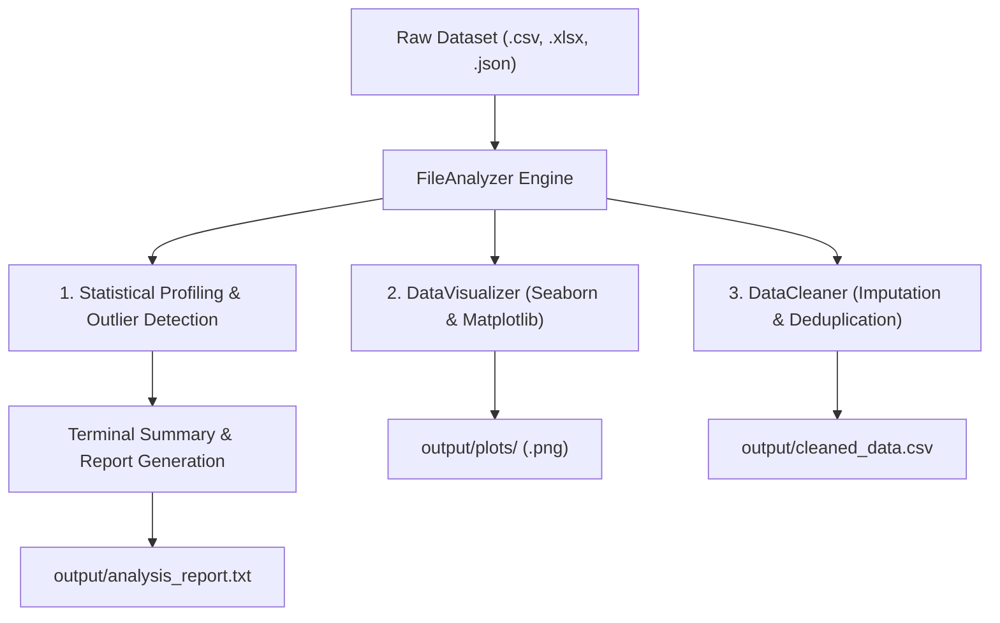

# 📊 File Data Analyzer & Automated EDA Engine

[](https://www.python.org/)
[](LICENSE)
[](https://pandas.pydata.org/)
[](https://numpy.org/)
[](https://github.com/gnanadeepreddy9)

> **An automated, end-to-end Exploratory Data Analysis (EDA), diagnostic visualization, and data sanitization engine built with Python.**

---

## 🌟 Overview

**File Data Analyzer** is a lightweight, high-performance command-line utility designed to eliminate tedious exploratory data analysis workflows. It accepts raw datasets in diverse formats (**CSV, Excel, JSON, TSV**), extracts statistical properties, detects missing values and outliers, automatically renders publication-ready data visualizations, cleans the data, and generates comprehensive reports with a single command.

---

## 🚀 Key Features

* 📁 **Multi-Format Ingestion:** Seamlessly reads `.csv`, `.xlsx`, `.xls`, `.json`, `.txt`, and `.tsv` files.
* 🔍 **Statistical Profiling:**
  * Shape, memory consumption, duplicate row enumeration.
  * Comprehensive descriptive stats: Mean, Median, Standard Deviation, Min, Max, and Skewness.
  * Robust outlier detection using the **Interquartile Range (IQR)** method.
* 🧹 **Automated Data Sanitization:**
  * Deduplication of identical records.
  * Smart imputation: **Median** for numerical features and **Mode** for categorical attributes.
  * Instant export of the sanitized dataset to `output/cleaned_data.csv`.
* 📈 **Diagnostic Visualizations:**
  * Missing value distribution bar charts.
  * Correlation heatmaps for numerical feature pairs.
  * Numerical feature probability density & histogram distributions.
* 📄 **Automated Reporting:** Generates an offline analytical summary report saved to `output/analysis_report.txt`.

---

## 🏗️ Project Architecture & Workflow



---

## 📂 Repository Structure

```text
file-data-analyzer/
│
├── sample_data/
│   └── sample_students.csv        # Sample student performance dataset for quick testing
│
├── src/
│   ├── __init__.py                # Package initialization
│   ├── analyzer.py                # Core statistical analysis and EDA engine
│   ├── visualizer.py              # Automated plot generator (Heatmaps, Histograms, Missing values)
│   └── cleaner.py                 # Imputation, deduplication, and dataset export
│
├── main.py                        # CLI entry point and interactive runner
├── requirements.txt               # Project dependencies
├── .gitignore                     # Git ignore rules for cached & generated files
├── LICENSE                        # Open-source MIT License
└── README.md                      # Comprehensive project documentation
```

---

## ⚡ Quick Start & Installation

### 1. Clone the Repository
```bash
git clone https://github.com/gnanadeepreddy9/file-data-analyzer.git
cd file-data-analyzer
```

### 2. Create and Activate a Virtual Environment (Optional but Recommended)
```bash
# Windows
python -m venv venv
venv\Scripts\activate

# Linux / macOS
python3 -m venv venv
source venv/bin/activate
```

### 3. Install Dependencies
```bash
pip install -r requirements.txt
```

---

## 💻 Usage

### Interactive Mode
Simply run the script without any arguments. It will prompt you for a file path, or you can hit **ENTER** to analyze the bundled sample dataset:
```bash
python main.py
```

### CLI Mode (Direct Path Argument)
Analyze any dataset directly using the `--file` / `-f` flag:
```bash
python main.py --file path/to/your_dataset.csv
```

---

## 📊 Sample Terminal Output

```text
======================================================================
  DATASET OVERVIEW
======================================================================
  * File Name             : sample_students.csv
  * Total Rows            : 15
  * Total Columns         : 10
  * Duplicate Rows        : 0
  * Memory Usage (KB)     : 1.75

======================================================================
  COLUMN ATTRIBUTES & MISSING DATA
======================================================================
           Column Data Type  Non-Null Count  Missing Values  Missing (%)  Unique Values
        StudentID     int64              15               0         0.00             15
             Name       str              15               0         0.00             14
     MidtermScore   float64              14               1         6.67             13
       FinalScore     int64              15               0         0.00             14
...

======================================================================
  GENERATING VISUALIZATIONS
======================================================================
  [+] Chart generated: output/plots/missing_values.png
  [+] Chart generated: output/plots/correlation_heatmap.png
  [+] Chart generated: output/plots/numerical_distributions.png

======================================================================
  PERFORMING AUTOMATED DATA CLEANING
======================================================================
  * Imputation (MidtermScore) : 1 nulls filled with median (81.0)
  * Sanitized File Saved: output/cleaned_data.csv

[OK] Complete Analysis Report saved to: output/analysis_report.txt
```

---

## 🛠️ Generated Artifacts

When execution finishes, the tool creates an `output/` directory containing:

| Artifact | Location | Description |
| :--- | :--- | :--- |
| **Cleaned Dataset** | `output/cleaned_data.csv` | Sanitized data with nulls imputed and duplicates dropped |
| **Analysis Report** | `output/analysis_report.txt` | Human-readable text report with all statistical tables |
| **Missing Values Plot**| `output/plots/missing_values.png` | Bar chart of null percentages per feature |
| **Correlation Heatmap**| `output/plots/correlation_heatmap.png` | Triangular correlation matrix of numeric variables |
| **Distributions** | `output/plots/numerical_distributions.png` | Histograms + KDE curves for numerical features |

---

## 🤝 Contributing

Contributions, issues, and feature requests are welcome!

1. **Fork** the project
2. Create your Feature Branch (`git checkout -b feature/AmazingFeature`)
3. **Commit** your changes (`git commit -m "Add some AmazingFeature"`)
4. **Push** to the branch (`git push origin feature/AmazingFeature`)
5. Open a **Pull Request (PR)**

---

## 📜 License

Distributed under the **MIT License**. See [`LICENSE`](LICENSE) for details.

---

## 👨‍💻 Author

**Sunkara Gnanadeep Reddy**  
*Undergraduate in Computer Science & Engineering (Data Science)*  
*Aditya University, Surampalem*  

* 🌐 **GitHub:** [@gnanadeepreddy9](https://github.com/gnanadeepreddy9)
* 💼 **LinkedIn:** [Sunkara Gnanadeep Reddy](https://linkedin.com/in/gnanadeep-reddy)
* 📧 **Email:** [gnanadeepreddy9@gmail.com](mailto:gnanadeepreddy9@gmail.com)
